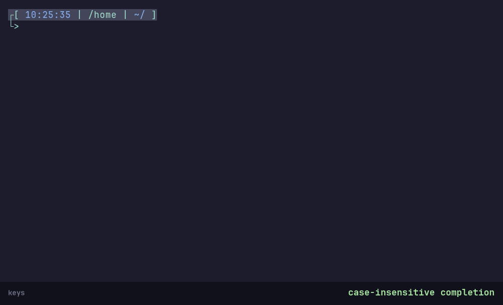
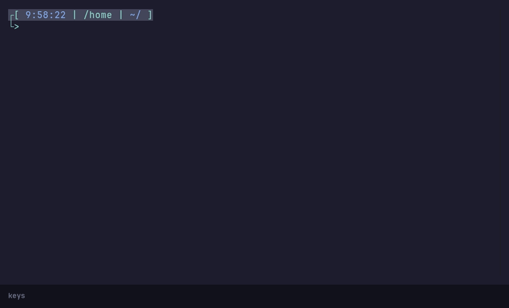
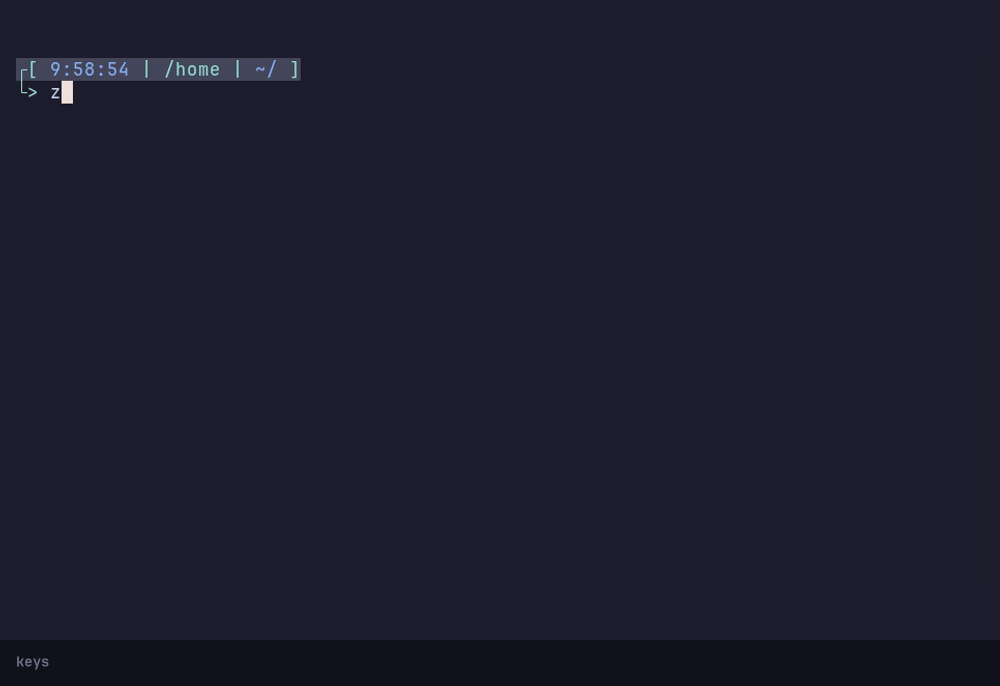
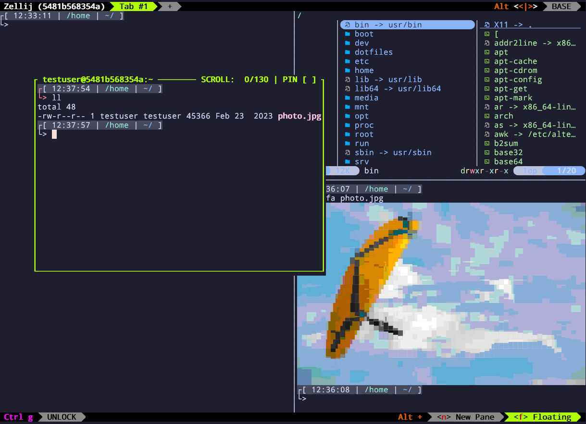
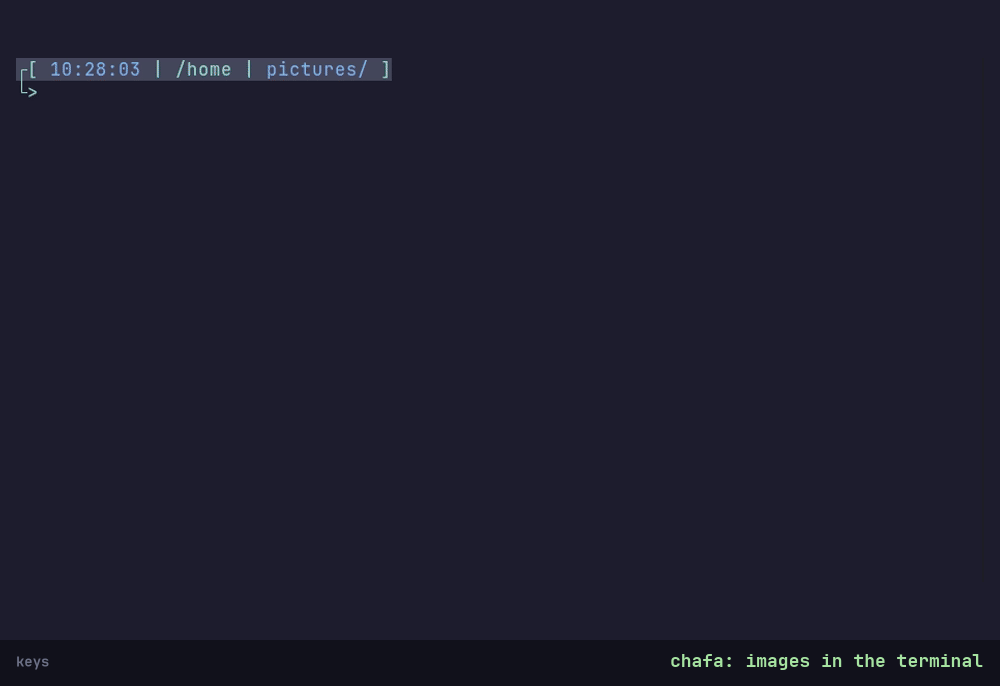

= Dotfiles
:toc:
:toc-placement: preamble

Personal dotfiles managed with https://www.chezmoi.io/[chezmoi].

chezmoi only tracks the dotfiles themselves.
All installation (packages, Oh My Zsh, the `jumo` theme, chezmoi itself) lives in a standalone `install.sh` bootstrap script.

Quick install on a fresh machine (see <<Install>> for options):

[source,shell]
----
sudo apt update && sudo apt install -y git
git clone https://github.com/jujumo/dotfiles.git ~/.local/share/chezmoi
sh ~/.local/share/chezmoi/install.sh
----

== Work environment

The old trio — terminator, tmux, bash — is replaced by a faster and friendlier one:

[cols="1,1,4",options="header",frame=none,grid=rows]
|===
| Before     | Now                | What it brings
| terminator | <<WezTerm>>        | GPU rendering, inline images, one Lua file for the whole config
| tmux       | <<Zellij>>         | shortcuts written on screen, floating and stacked panes, sessions that survive a lost connection
| bash       | <<Zsh + Oh My Zsh>> | completion you can browse, plugins, a prompt that tells you when something failed
|===

=== Zsh + Oh My Zsh

==== Completion you can walk through

`Tab` completes what is unambiguous, whatever the case (`cd Pro` finds `projects/`), `Tab` again lists the candidates, and one more `Tab` enters the list: from there `Tab` and the arrow keys move in every direction, `Enter` picks the highlighted entry without running the command — ready to complete the next level.

==== Plugins and prompt

* *`jumo` prompt* — time, root of the current path (which disk am I on?), current directory, conda environment when one is active; the frame turns red when the last command failed.
* *`sudo`* — forgot it? `Esc` `Esc` puts `sudo` in front of the current (or previous) command.
* *`gitfast`* — completes git sub-commands, branches, remotes.
* *`fzf`* — `Ctrl+R` fuzzy-searches the history, `**` + `Tab` fuzzy-completes paths.
* *`common-aliases`* — `la`, `ll`, `l` and friends.
* *`copypath`, `copybuffer`* — copy the current directory, or the command line being typed (`Ctrl+O`), to the clipboard.
* *`direnv`* — per-directory environment, loaded on `cd`.
* *`ssh-agent`* — one agent per host, keys loaded lazily on first use.

The full list is in link:dot_zshrc[`dot_zshrc`]; custom aliases live in link:dot_oh-my-zsh/custom[`dot_oh-my-zsh/custom`].

=== Zellij

* *No shortcut to memorise* — the bottom bar always shows the keys available in the current mode.
* *Locked by default* — zellij leaves every key to the shell and to the programs running in it. `Ctrl+g` unlocks it, then `p` (pane), `t` (tab), `r` (resize), `s` (scroll/search), `o` (session)... and it locks itself again once the action is done.
* *`Alt` shortcuts work while locked* — `Alt+arrows` (or `Alt+hjkl`) move the focus across panes and tabs, `Alt+n` opens a pane, `Alt+f` toggles the floating panes.
* *`zel`* — attach to this machine's session, creating it if needed (the session is named after the host).
* *`zel_<host>`* — one alias per host of `~/.ssh/config`: ssh there and land in its persistent zellij session (falls back to tmux, then to a plain shell). Close the window or lose the network: the session only detaches.

Configuration: link:dot_config/zellij/config.kdl[`dot_config/zellij/config.kdl`].

=== WezTerm

* *GPU-accelerated* rendering (WebGPU front end).
* *Inline images* — Sixel, iTerm2 and kitty graphics protocols, so image previews work in `yazi` and the like.
* *Catppuccin Mocha* palette and a Nerd Font (`RobotoMono Nerd Font Mono`, to be installed separately).
* *Linux-style selection* — selecting with the mouse fills the PRIMARY selection, middle-click pastes.
* The whole configuration is one Lua file: link:dot_config/wezterm/wezterm.lua[`dot_config/wezterm/wezterm.lua`].

==== Images in the terminal

`chafa` shows a picture right where you are, no viewer window, also over ssh:

The demo is recorded in a headless terminal, so the picture is drawn with coloured character cells. In a terminal that speaks a graphics protocol, such as WezTerm, `chafa` uses it and draws real pixels.

WezTerm itself is not installed by `install.sh` (a desktop application): install it from https://wezterm.org/install/linux.html[wezterm.org]; chezmoi only provides its configuration.

== What you get

[cols="1,4",frame=none,grid=none]
|===
| Zsh shell      | zsh as login shell, Oh My Zsh (without its own `.zshrc` — chezmoi owns that), the `jumo` prompt theme
| Dotfiles       | chezmoi (in `~/.local/bin`), applying this repo
| SSH            | `openssh-client`; opt-in login: `openssh-server` + keys from `SSH_KEYS_URL` in `authorized_keys` (see <<Authorizing SSH login keys>>)
| Downloads      | `curl`, `wget`, `ca-certificates`
| Git            | `git`, `lazygit`{asterisk} (terminal UI; GitHub release when AppMan has no lazygit, e.g. ARM)
| Editors        | `nano`, `micro`
| Multiplexers   | `screen`, `zellij`
| File browsing  | `yazi` (file manager), `tree`, `fzf`{asterisk} (fuzzy finder, zsh integration; GitHub release when AppMan has no fzf, e.g. ARM)
| `btop`         | resource monitor
| `chafa`        | images in the terminal
| Trash          | `trash-cli` (instead of `rm`)
| Archives       | `unzip`, `bzip2`, `7z` (`7zip` package), `xz`
| Build tools    | `build-essential`, `perl`
| Python         | `uv`
| `direnv`       | per-directory environment
| GNU `parallel` | run jobs in parallel
| AppMan         | user-level app manager
|===

{asterisk} installed via AppMan

System packages need root (apt); everything else installs into your home directory.

Files not meant for `$HOME` (`README.adoc`, `CLAUDE.md`, `install.sh`) are excluded via `.chezmoiignore`.

=== Re-recording the demos

The GIFs in `docs/` are scripted with https://github.com/charmbracelet/vhs[VHS]: each one replays a `.tape` file (keystrokes and pauses) in a container where `install.sh` has run; the strip at the bottom, showing the keys being pressed, is added afterwards from the same tape. Tapes and the `make demo` target live in the companion test project (`chezmoi_docker_test`).

== Install

On a fresh machine, install git, clone the repo straight into chezmoi's source directory, and run the installer from there. The repo is private: the clone needs an SSH key registered on es.naverlabs.com. The clone names its remote `naver` and adds `github`, the public upstream (see <<_synchronize_from_jujumo>>):

[source,shell]
----
sudo apt update && sudo apt install -y git
git clone -o naver -b work git@es.naverlabs.com:julien-morat/dotfiles.git ~/.local/share/chezmoi
git -C ~/.local/share/chezmoi remote add github git@github.com:jujumo/dotfiles.git
sh ~/.local/share/chezmoi/install.sh
----

This installs the packages and tools listed above, then applies the dotfiles from that clone (including the `jumo` theme). The source repo is the clone's `naver` remote: to use another repo, clone that one instead.

Installation is best effort: a step that lacks permissions or prerequisites is skipped and the next one runs. Without root or passwordless sudo, the installer asks once whether to use sudo. Two environment variables change this:

* `NO_ROOT=1` — never use sudo (system packages are skipped).
* `UNATTENDED=1` — never prompt (steps that would need a password are skipped).

=== Authorizing SSH login keys

Set `SSH_KEYS_URL` when running step 3 to also authorize SSH keys for logging *into* this machine. The installer fetches the public keys from that URL and appends them to `~/.ssh/authorized_keys` (append-only and idempotent — existing entries are left untouched), and installs `openssh-server` so the host is reachable. Unset by default, so nothing is authorized unless you opt in.

The handiest source is your GitHub account's public keys:

[source,shell]
----
SSH_KEYS_URL=https://github.com/jujumo.keys sh ~/.local/share/chezmoi/install.sh
----

Any URL `curl` can read works (including a local `file://` path). Only *public* keys are ever handled — no private key material is involved.

== Rust (cargo)

Not handled by `install.sh`. Do _not_ use `appman` for it: its `cargo` is `cargo-appimage`, an unrelated tool that shadows the real one.

Install `rustup` the default way (into `~/.cargo` and `~/.rustup`), then link the rustup tools into `~/.local/bin`, which is already on `PATH`:

[source,shell]
----
curl -sSf https://sh.rustup.rs | sh -s -- -y --no-modify-path
ln -s ~/.cargo/bin/{cargo,rustc,rustup} ~/.local/bin/
----

chezmoi provides `~/.cargo/config.toml` (from `dot_cargo/config.toml.tmpl`), which sets `install.root` to `~/.local`. A plain `cargo install --path .` therefore puts binaries straight into `~/.local/bin`, with no symlink. The order does not matter: rustup keeps an existing `config.toml`. The path must be absolute, as cargo does not expand `~` and resolves a relative `install.root` against the current directory.

== Update

`install.sh` is idempotent and is also the update command: re-run it and it pulls the latest commits of the source repo and applies them (steps already done — Oh My Zsh, chezmoi — are skipped). Pull first, so that a change to `install.sh` itself (a new package, for example) is the version that runs:

[source,shell]
----
git -C ~/chezmoi pull        # ~/chezmoi is a symlink to ~/.local/share/chezmoi, created by install.sh
sh ~/chezmoi/install.sh
----

For the dotfiles only, without going through the package step:

[source,shell]
----
chezmoi update             # git pull + apply
----

NOTE: `chezmoi update` rebases the source directory. If you have local commits there that are not pushed, the pull can stop on a conflict — nothing is applied until you resolve it.

== install specific dev tools

=== slurmer

TODO

=== claude_tui

[source,bash]
----
wget https://raw.githubusercontent.com/slima4/claude-tui/main/install.sh 
conda create -n claudetui python=3.14
CLAUDETUI_PYTHON="$HOME/miniconda3/envs/claudetui/bin/python"
INSTALL_DIR="$HOME/Applications/claude-tui"
./install.sh 
----

== Synchronize from jujumo

When the public repo changes, the synchronization procedure is:

----
# retrieve upstream modifications from main on github.
git switch main
git fetch github
git merge --ff-only github/main
# apply modifications to work branch
git switch work
git merge main
git push naver work
git push naver main
----

or calls: 
----
./merge_perso.sh
----

== Day-to-day usage

[source,shell]
----
chezmoi apply              # apply changes to $HOME
chezmoi diff               # preview changes
chezmoi add ~/.someconfig  # track a new file
chezmoi edit ~/.zshrc --apply
----
