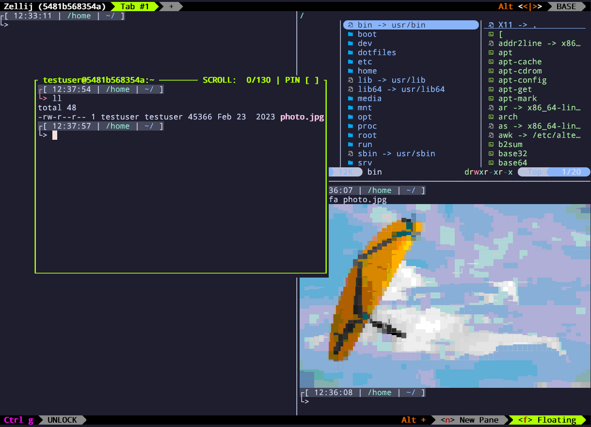

= Dotfiles
:toc:
:toc-placement: preamble

Personal dotfiles managed with https://www.chezmoi.io/[chezmoi].

chezmoi only tracks the dotfiles themselves.
All installation (packages, Oh My Zsh, the `jumo` theme, chezmoi itself) lives in a standalone `install.sh` bootstrap script.

Quick install on a fresh machine (see <<Install>> for options):

[source,shell]
----
sudo apt update && sudo apt install -y git
git clone https://github.com/jujumo/dotfiles.git ~/.local/share/chezmoi
sh ~/.local/share/chezmoi/install.sh
----

== What you get

.How it looks like

[cols="1,4",frame=none,grid=none]
|===
| Zsh shell      | zsh as login shell, Oh My Zsh (without its own `.zshrc` — chezmoi owns that), the `jumo` prompt theme
| Dotfiles       | chezmoi (in `~/.local/bin`), applying this repo
| SSH            | `openssh-client`; opt-in login: `openssh-server` + keys from `SSH_KEYS_URL` in `authorized_keys` (see <<Authorizing SSH login keys>>)
| Downloads      | `curl`, `wget`, `ca-certificates`
| Git            | `git`, `lazygit`{asterisk} (terminal UI; GitHub release when AppMan has no lazygit, e.g. ARM)
| Editors        | `nano`, `micro`
| Multiplexers   | `screen`, `zellij`
| File browsing  | `yazi` (file manager), `tree`, `fzf`{asterisk} (fuzzy finder, zsh integration; GitHub release when AppMan has no fzf, e.g. ARM)
| `btop`         | resource monitor
| Trash          | `trash-cli` (instead of `rm`)
| Archives       | `unzip`, `bzip2`, `7z`{asterisk}
| Build tools    | `build-essential`, `perl`
| Python         | `uv`
| `direnv`       | per-directory environment
| GNU `parallel` | run jobs in parallel
| AppMan         | user-level app manager
|===

{asterisk} installed via AppMan

System packages need root (apt); everything else installs into your home directory.

Files not meant for `$HOME` (`README.adoc`, `CLAUDE.md`, `install.sh`) are excluded via `.chezmoiignore`.

== Install

On a fresh machine, install git, clone the repo straight into chezmoi's source directory, and run the installer from there:

[source,shell]
----
sudo apt update && sudo apt install -y git
git clone https://github.com/jujumo/dotfiles.git ~/.local/share/chezmoi
sh ~/.local/share/chezmoi/install.sh
----

This installs the packages and tools listed above, then applies the dotfiles from that clone (including the `jumo` theme). The source repo is the clone's `origin`: to use another repo, clone that one instead.

Installation is best effort: a step that lacks permissions or prerequisites is skipped and the next one runs. Without root or passwordless sudo, the installer asks once whether to use sudo. Two environment variables change this:

* `NO_ROOT=1` — never use sudo (system packages are skipped).
* `UNATTENDED=1` — never prompt (steps that would need a password are skipped).

=== Authorizing SSH login keys

Set `SSH_KEYS_URL` when running step 3 to also authorize SSH keys for logging *into* this machine. The installer fetches the public keys from that URL and appends them to `~/.ssh/authorized_keys` (append-only and idempotent — existing entries are left untouched), and installs `openssh-server` so the host is reachable. Unset by default, so nothing is authorized unless you opt in.

The handiest source is your GitHub account's public keys:

[source,shell]
----
SSH_KEYS_URL=https://github.com/jujumo.keys sh ~/.local/share/chezmoi/install.sh
----

Any URL `curl` can read works (including a local `file://` path). Only *public* keys are ever handled — no private key material is involved.

== Rust (cargo)

Not handled by `install.sh`. Do _not_ use `appman` for it: its `cargo` is `cargo-appimage`, an unrelated tool that shadows the real one.

Install `rustup` the default way (into `~/.cargo` and `~/.rustup`), then link the rustup tools into `~/.local/bin`, which is already on `PATH`:

[source,shell]
----
curl -sSf https://sh.rustup.rs | sh -s -- -y --no-modify-path
ln -s ~/.cargo/bin/{cargo,rustc,rustup} ~/.local/bin/
----

chezmoi provides `~/.cargo/config.toml` (from `dot_cargo/config.toml.tmpl`), which sets `install.root` to `~/.local`. A plain `cargo install --path .` therefore puts binaries straight into `~/.local/bin`, with no symlink. The order does not matter: rustup keeps an existing `config.toml`. The path must be absolute, as cargo does not expand `~` and resolves a relative `install.root` against the current directory.

== Update

`install.sh` is idempotent and is also the update command: re-run it and it pulls the latest commits of the source repo and applies them (steps already done — Oh My Zsh, chezmoi — are skipped). Pull first, so that a change to `install.sh` itself (a new package, for example) is the version that runs:

[source,shell]
----
git -C ~/chezmoi pull        # ~/chezmoi is a symlink to ~/.local/share/chezmoi, created by install.sh
sh ~/chezmoi/install.sh
----

For the dotfiles only, without going through the package step:

[source,shell]
----
chezmoi update             # git pull + apply
----

NOTE: `chezmoi update` rebases the source directory. If you have local commits there that are not pushed, the pull can stop on a conflict — nothing is applied until you resolve it.

== Day-to-day usage

[source,shell]
----
chezmoi apply              # apply changes to $HOME
chezmoi diff               # preview changes
chezmoi add ~/.someconfig  # track a new file
chezmoi edit ~/.zshrc --apply
----
